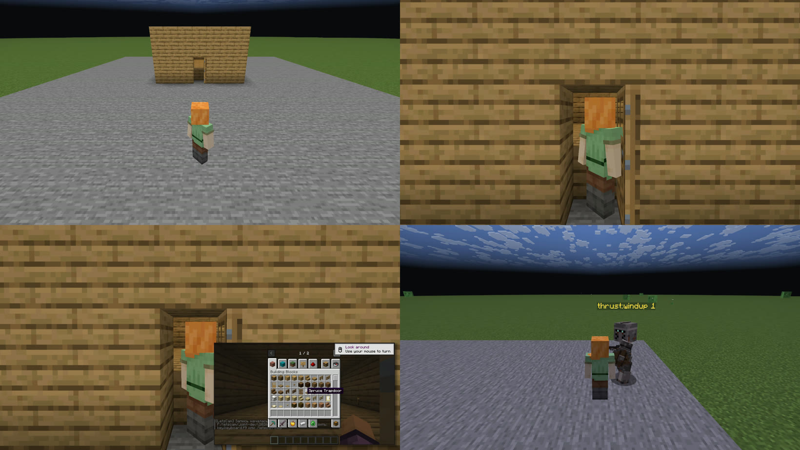
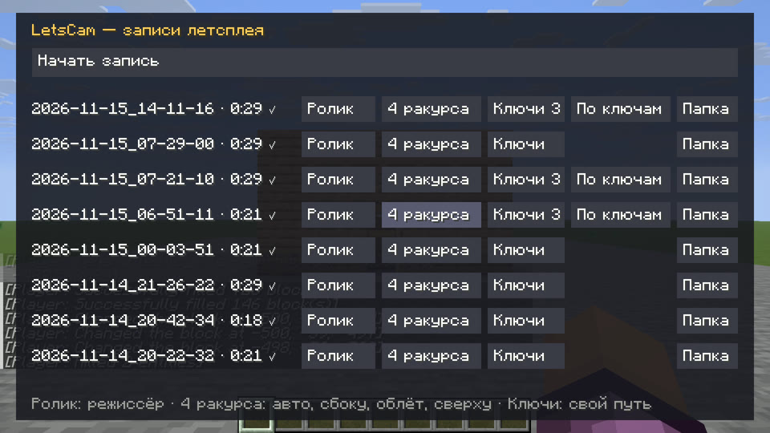
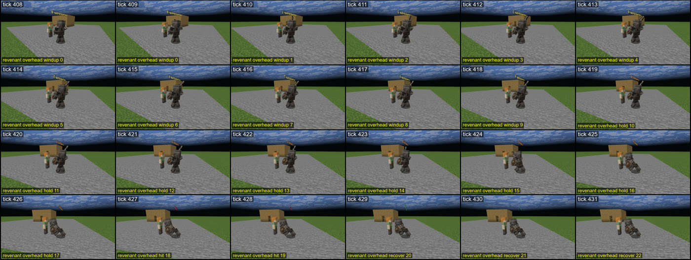

<div align="center">

# LetsCam

**Запись летсплеев для Minecraft на [Horizon](https://github.com/horizon-rust/horizon): вы играете как обычно, а ролик потом снимает невидимая камера от третьего лица.**




<sub>Один ролик камеры-режиссёра: подход к дому, дверь, инвентарь картинкой в картинке, бой с ревенантом SoulsCraft.</sub>

</div>

## Что это

Пока вы играете, LetsCam почти ничего не делает. Он тихо пишет четыре вещи:
- реплей студии Horizon;
- звук игры;
- микрофон;
- кадры открытого инвентаря.

Игра не теряет кадров: всё тяжёлое ждёт до конца записи.

Потом одна команда выходит из мира, открывает реплей и снимает по нему ролик. Работает камера-режиссёр: она следует за персонажем, меняет плечо, проходит в двери, держится под потолком в тесных комнатах и облетает персонажа, пока открыт инвентарь. Кадры кодирует видеокарта (NVENC). В ролике 1080p60 и две отдельные звуковые дорожки, «Игра» и «Микрофон», выровненные до кадра.

Одну запись можно перерендерить сколько угодно раз, с любыми ракурсами:
- облёт, сбоку, сверху, с плеча или от первого лица;
- со своим путём камеры по ключевым кадрам;
- в замедлении;
- с камерой на мобе вместо игрока.

## Возможности

- **Запись по F9.** В углу горит `● REC 0:00`, в ролик метка не попадает.
- **Окно записей по F10.** В нём восемь последних записей, у каждой рендер одной кнопкой.
- **Камера-режиссёр.** Двери, потолки, смена плеча, облёт при открытом инвентаре.
- **Ракурсы.** Можно рендерить несколько подряд из одной записи: `auto+orbit+side+top`.
- **Ключевые кадры.** Свободной камерой ставите ключи на паузе реплея, камера плавно летит по ним.
- **Замедление до 0,05×** и **листы кадров** с номером тика на каждом кадре, удобно для разбора анимаций.
- **Фокус на сущности.** Камера держит в кадре моба или то, на чём вы едете, а не игрока.
- **Фазы атак [SoulsCraft](https://github.com/Betreazen/soulscraft)** подписываются на листах кадров.
- **Интерфейс картинкой в картинке.** Инвентарь, открытый во время игры, появляется в углу ролика.
- **Две дорожки звука**: игра (только процесс игры, не весь компьютер) и микрофон.
- **Настройки**: разрешение до 8K, 30 или 60 кадров, H.264, HEVC или AV1, MP4 или MKV, качество.

<p align="center">
<br>
<sub>Окно записей (F10): рендер любой записи одной кнопкой.</sub>
</p>

<p align="center">
<br>
<sub>Лист кадров в замедлении, камера на ревенанте SoulsCraft: удар сверху по тикам, замах → удержание → удар → восстановление.</sub>
</p>

## Установка

Нужны:
- [лаунчер Horizon](https://github.com/horizon-rust/horizon) и лицензионный Minecraft: Java Edition;
- Windows 10 или 11: звук игры пишется через WASAPI;
- видеокарта NVIDIA для NVENC (без неё работает программный кодек, только медленнее);
- [ffmpeg](https://ffmpeg.org/download.html#build-windows), например сборка gyan.dev или BtbN. Мод не может нести ffmpeg в себе.

> [!WARNING]
> Нативный мод Horizon лаунчер компилирует у вас на компьютере, и он работает с вашими правами, без песочницы. Перед установкой прочитайте код. Лаунчер попросит подтвердить, что вы доверяете моду.

**Какая версия нужна.** LetsCam 0.2 написан на Mod API Horizon. Лаунчер собирает его против готовой игры той сборки Horizon, к которой он привязан, игру при этом не пересобирает. Сейчас это Nightly 2026-11-21 (`8f83e5c`), сборка указана в `mod/letscam/horizon-mod.toml` (`[native] horizon`). Мод вмешивается во внутренние функции игры, поэтому собирается только на этой сборке; переход на новую выходит новой версией мода. Для старого лаунчера, до слияния Mod API (0.2.69 и раньше), — LetsCam 0.1.2.

**В окне лаунчера:** Mods → **Add from GitHub** → вставьте `https://github.com/Betreazen/letscam` → **Build**.

**Из командной строки:**

```powershell
horizon-launcher install nightly-2026-11-21-8f83e5c
horizon-launcher prepare --version nightly-2026-11-21-8f83e5c
horizon-launcher mods add-github https://github.com/Betreazen/letscam --trust-native-code
horizon-launcher native-build --trust-native-code
```

Первая сборка скачивает части SDK этой сборки Horizon (около 300 МБ) и Rust лаунчера, это несколько минут. Дальше пересборка занимает от полуминуты до двух минут.

Мод только клиентский: серверу он не нужен, играть с ним можно на любом сервере. В сборке [pack-sync](https://github.com/Betreazen/horizon-pack-sync) указывайте его с `"side": "client"`: в серверный движок он попадать не должен.

Если ffmpeg не лежит в `PATH`, укажите путь к нему в `config/letscam-client.toml` (ключ `ffmpeg`), затем `/letscam reload`.

## Как пользоваться

1. В мире нажмите **F9** или введите `/letscam start`.
2. Играйте. **F9** или `/letscam stop` останавливает запись.
3. `/letscam render` рендерит последнюю запись. Готовый ролик лежит рядом с ней, путь мод пишет в чат. Отмена: Esc или `/letscam cancel`.

Вместо команд можно открыть окно записей (**F10** или `/letscam`). У каждой записи в нём кнопки:
- **«Ролик»** — камера-режиссёр;
- **«4 ракурса»** — авто, сбоку, облёт и сверху, у каждого лист кадров;
- **«Ключи»** — свой путь камеры;
- **«По ключам»** — ролик по нему;
- **«Папка»**.

Галочка ✓ значит, что ролик уже есть. Клавиши F9 и F10 меняются в «Настройки → Управление».

Во время рендера играть нельзя: клиент занят реплеем.

### Ракурсы, замедление, фокус

```text
/letscam render [папка] [ракурс[+ракурс…]] [x0.25] [sheet[=тиков]] [focus=id|тип|ride]
```

| Опция | Что делает |
|---|---|
| `auto` | камера-режиссёр (по умолчанию) |
| `fp`, `shoulder` | глаза игрока, через плечо |
| `orbit`, `side`, `front`, `top` | облёт, сбоку, спереди, сверху |
| `fixed:x,y,z` | неподвижная камера в точке, смотрит на игрока |
| `keys` | путь по ключевым кадрам |
| `x0.25` | замедление от 0,05 до 1; при замедлении звук не пишется |
| `sheet`, `sheet=1` | листы кадров: кадр раз в 2 тика или каждый тик |
| `focus=…` | камера следит за сущностью: по id, по типу (`soulscraft:revenant`) или за тем, на чём едет игрок (`ride`) |

Например: `/letscam render orbit+side x0.25 sheet=1 focus=soulscraft:revenant`.

### Свой путь камеры

`/letscam edit [папка]` (или «Ключи» в окне) открывает реплей на паузе со свободной камерой. WASD и мышь двигают камеру.

| Клавиша | Что делает |
|---|---|
| **N** | ключ: поза камеры в этот момент реплея |
| **Del** | убрать ближайший ключ |
| **K** | пауза и продолжение |
| **← / →** | на секунду назад или вперёд |
| **P** | посмотреть путь |
| **Enter** | сохранить и выйти |

Путь хранится в самом `replay.mcpr`, как его хранит студия Horizon. Ролик по нему: `/letscam render keys`. Между ключами камера летит плавно, до первого ключа и после последнего стоит на месте.

### Фазы атак SoulsCraft на листах

> [!NOTE]
> Подписям нужен SoulsCraft, перенесённый на Mod API. Пока его нет, строк на листах не будет.

Если на сервере стоит SoulsCraft, внизу каждого кадра на листе идёт жёлтая строка, например `revenant overhead windup 7`. Строка совпадает с меткой над мобом кадр в кадр.

Названия фаз приходят, только если во время записи был включён `/sc debug on`. Без него строка показывает атаку и тики от её начала, например `overhead +12`. Мобы в покое не подписываются.

### Другие команды

- `/letscam list` — последние записи;
- `/letscam reload` — перечитать настройки.

## Что получается

Каждая запись — папка `letscam/<дата_время>/` в папке игры (по местному времени):

| Файл | Что |
|---|---|
| `replay.mcpr` | реплей; по нему можно рендерить сколько угодно раз |
| `letscam_<дата_время>[_ракурс][_фокус][_xскорость].mp4` | ролики; рендеры одной записи не затирают друг друга |
| `…_sheet_NN.png` | листы кадров |
| `game.wav`, `mic.wav`, `gui/` | черновики; удаляются после рендера, если `keep_sources = false` |
| `session.json`, `world_time.json` | служебные: время дорожек, события интерфейса, след игрока, время суток |

## Настройки

`config/letscam-client.toml` создаётся при первом запуске, у каждого ключа есть комментарий:

| Ключ | По умолчанию | Что |
|---|---|---|
| `ffmpeg` | `ffmpeg` из `PATH` | путь к ffmpeg |
| `output_dir` | `letscam` в папке игры | папка записей |
| `width`, `height`, `fps` | 1920 × 1080, 60 | разрешение до 8K, 30 или 60 кадров |
| `codec`, `hardware`, `quality` | HEVC, на видеокарте, 23 | H.264, HEVC или AV1; NVENC или программный кодек |
| `container` | MP4 | MP4 или MKV |
| `record_mic`, `mic_device` | включён, устройство по умолчанию | микрофон и его устройство |
| `keep_sources` | `true` | оставлять ли WAV и кадры интерфейса после рендера |
| `[director]` | | все числа камеры-режиссёра: пружины, дистанция, плечо, потолок |

## Известные ограничения

- **Обрыв записи.** Рекордер студии Horizon обрывает запись, если диск на несколько секунд встаёт: его очередь на 2048 пакетов переполняется ([#16041](https://github.com/horizon-rust/horizon/issues/16041)). LetsCam сразу пишет об этом в чат.
- **Игрок в дверях.** Модель игрока в реплее может забегать вперёд, пока игрок стоит в клетке открытой двери ([#16527](https://github.com/horizon-rust/horizon/issues/16527)).
- **Замирание в начале.** При старте записи игра на миг замирает, пока рекордер сохраняет снимок мира.
- **Звук только в Windows.** Звук игры пишется только в Windows.
- **Одна камера.** Живой второй камеры во время игры нет, ролик всегда рендерится после.
- **Свёрнутое окно.** Во время рендера окно игры лучше не сворачивать: свёрнутое Horizon рисует 10 кадров в секунду (Dynamic FPS — 1), и рендер замедляется, пока окно не развернут. Переключаться на другие окна можно.

- **Подписи ждут SoulsCraft.** Фазы атак появятся на листах, когда SoulsCraft выйдет на Mod API, см. выше.
- **Рендер медленнее.** На новой сборке Horizon кадр рендера идёт ~19–20 мс против ~13 мс раньше: ролик рендерится примерно на треть дольше. Причину ищем.

Пакеты вложений и время суток Horizon теряет в реплеях ([#16039](https://github.com/horizon-rust/horizon/issues/16039), [#16040](https://github.com/horizon-rust/horizon/issues/16040)), LetsCam обходит это сам.

## Разработка

Устройство мода, тесты и проверки ботом — [docs/development.md](docs/development.md). 3D-сцена для сайта проекта строится кодом в Blender: [site/scene/build_scene.py](site/scene/build_scene.py). Спецификация и журнал проверок — [docs/design/01-spec.md](docs/design/01-spec.md). История версий — [CHANGELOG.md](CHANGELOG.md).

## In English

LetsCam is a client-only native mod for [Horizon](https://github.com/horizon-rust/horizon), the Rust reimplementation of Minecraft 26.3, for recording let's plays.

**While you play.** Press F9. LetsCam quietly records the studio replay, the game's own audio, your microphone and snapshots of open screens, so the game keeps its frame rate.

**Afterwards.** `/letscam render` reopens the replay and films it with an invisible third-person director camera. The camera follows you through doors, under ceilings and around you while the inventory is open. The GPU encodes the frames (NVENC). The result is a 1080p60 video with separate game and microphone tracks.

**More from one recording.** Render it again from other angles (orbit, side, top, shoulder, first person, a keyframed path), in slow motion, with contact sheets frame by frame, or with the camera on a mob.

**Install.** LetsCam 0.2 is a native mod on Horizon's mod API, built by the launcher against the prebuilt game of the Horizon build it pins (`[native] horizon` in `mod/letscam/horizon-mod.toml`, currently nightly 2026-11-21, `8f83e5c`); the game is never rebuilt. Install that build, then in the launcher choose **Mods → Add from GitHub** and paste this repository's link. You also need ffmpeg. Native mods run unsandboxed with your rights, so read the source first. For launchers before the mod API (0.2.69 and older) use LetsCam 0.1.2.

## Лицензия

[MIT](LICENSE). Мод не связан с Mojang, Microsoft и проектом Horizon и не одобрен ими. Для игры нужен лицензионный Minecraft: Java Edition.
